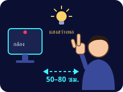
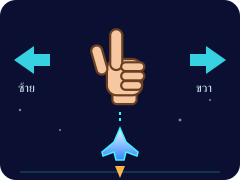
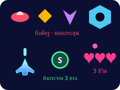
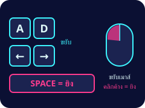

# Space Finger Gun — เกมยิงยานอวกาศด้วยท่ามือ

เว็บเกม Space Shooter ที่ควบคุมด้วย **ท่ามือทำปืน** ผ่านกล้องเว็บแคม ใช้ [Google MediaPipe Hand Landmarker](https://ai.google.dev/edge/mediapipe/solutions/vision/hand_landmarker) (`@mediapipe/tasks-vision`)
ทุกอย่างรันออนไลน์ในเบราว์เซอร์: ไลบรารี ไฟล์ WASM และโมเดลโหลดจาก CDN ไม่ต้องติดตั้งหรือ build อะไรเลย

## วิธีเล่น

| | |
|---|---|
|  | **1. เตรียมตัว** — นั่งห่างกล้อง **50–80 ซม.** ในที่มีแสงสว่างพอ ยกมือขึ้น 1 ข้าง หันฝ่ามือเข้าหากล้อง |
|  | **2. ทำท่าปืน** — ชูนิ้วชี้ขึ้น ตั้งนิ้วโป้งขึ้น นิ้วที่เหลือกำไว้ |
|  | **3. บังคับยาน** — เลื่อนมือไปทางซ้าย ยานไปซ้าย เลื่อนไปทางขวา ยานไปขวา (ใช้แค่ช่วงกลางภาพกล้อง ไม่ต้องยื่นมือจนสุดขอบ) |
|  | **4. ยิง** — กดนิ้วโป้งลงแตะนิ้วชี้ = ยิง 1 นัด ยกนิ้วโป้งขึ้นเพื่อง้างใหม่ ถ้ากดค้างจะยิงต่อเนื่องช้า ๆ |
|  | **5. เป้าหมาย** — ยิงศัตรูเก็บคะแนน หลบศัตรูและกระสุน เก็บไอเทม **S** เพื่อยิงกระจาย 3 ทาง (8 วินาที) มี 3 ชีวิต |
|  | **6. ไม่มีกล้อง?** — `A`/`D` หรือ `←`/`→` เพื่อขยับ, `Space` เพื่อยิง หรือขยับเมาส์ + คลิกค้างเพื่อยิง |

ปุ่มอื่น ๆ: `P` หรือ `Esc` หยุดชั่วคราว, `M` เปิด/ปิดเสียง

### เคล็ดลับ
- ในหน้า **วิธีเล่น** มีช่องทดลองท่ามือ ไฟ "เจอมือ / ท่าปืนถูกต้อง / ยิง!" จะติดแบบเรียลไทม์
- ถ้ายิงยากหรือยิงเอง ให้กด **🎯 ปรับเทียบนิ้วโป้ง** แล้วทำตามขั้นตอน (ตั้งนิ้วโป้งค้าง 1 วิ → กดลงค้าง 1 วิ) ค่าจะถูกบันทึกไว้ในเบราว์เซอร์
- ถ้าเครื่องช้า ลองปิดแท็บอื่น ๆ เกมจะใช้ GPU ถ้ามี และสลับเป็น CPU ให้อัตโนมัติ

## รันเกม

กล้องเว็บแคมใช้ได้เฉพาะบน **https** หรือ **localhost** เท่านั้น (เปิดไฟล์ `index.html` ตรง ๆ แบบ `file://` จะใช้ไม่ได้)

**ทดสอบในเครื่อง** (ยังโหลด MediaPipe จาก CDN ออนไลน์):

```bash
npx serve .
# หรือ
python -m http.server 8000
```

แล้วเปิด `http://localhost:3000` (หรือ `:8000`) ใน Chrome / Edge

**ขึ้นออนไลน์** — อัปโหลดทั้งโฟลเดอร์ไปที่ static hosting ใดก็ได้ เช่น
- **GitHub Pages**: push ขึ้น repo → Settings → Pages → Deploy from branch (`main`, `/root`)
- **Netlify / Cloudflare Pages / Vercel**: ลากโฟลเดอร์ไปวาง หรือเชื่อม repo (ไม่ต้องตั้ง build command)

## โครงสร้างไฟล์

```
index.html        หน้าเกม เมนู วิธีเล่น
style.css         สไตล์นีออน
img/*.svg         ภาพประกอบวิธีเล่น (มีแอนิเมชัน)
js/main.js        เชื่อมทุกส่วน ลูปหลัก จัดการหน้าจอ
js/handTracker.js โหลด MediaPipe Hand Landmarker จาก CDN + เว็บแคม
js/input.js       ท่ามือทำปืน: ตำแหน่งมือ → ยาน, นิ้วโป้งลง → ยิง, ปรับเทียบ, คีย์บอร์ด/เมาส์
js/game.js        ตรรกะเกม ศัตรู การชน คะแนน ชีวิต
js/entities.js    คลาสยาน ศัตรู กระสุน ไอเทม พาร์ทิเคิล
js/render.js      วาดกราฟิกด้วย Canvas 2D + ภาพกล้องพร้อมโครงมือ
js/audio.js       เสียงเอฟเฟกต์ด้วย WebAudio
js/tutorial.js    ทดลองท่ามือสด + ปรับเทียบ
```

## การตรวจจับท่ามือ (สำหรับนักพัฒนา)

- ตำแหน่งยาน = ค่า x เฉลี่ยของโคนนิ้วชี้ (landmark 5) กับข้อมือ (0) กลับด้านแบบกระจก ใช้ช่วง 15–85% ของภาพ และ smooth ด้วย EMA
- ไกปืน: `d = dist(ปลายนิ้วโป้ง 4, โคนนิ้วชี้ 5) / dist(ข้อมือ 0, โคนนิ้วกลาง 9)`
  - `d < 0.45` = นิ้วโป้งลง (ยิง), `d > 0.65` = นิ้วโป้งขึ้น (ง้าง) — มี hysteresis กันสั่น ค่าปรับได้ด้วยการปรับเทียบ
  - ยิงตอนเปลี่ยนจากขึ้น → ลง 1 นัด และยิงซ้ำทุก 400ms ถ้ากดค้าง
