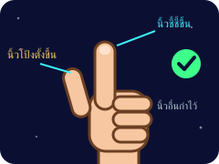
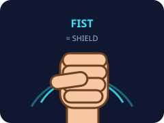
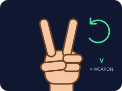
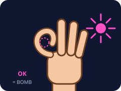
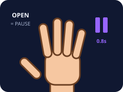

# Space Finger Gun — AI Hand Tracking Space Battle

เว็บเกมยิงยานอวกาศที่ควบคุมด้วย **ท่ามือ** ผ่านเว็บแคม ใช้ [Google MediaPipe Hand Landmarker](https://ai.google.dev/edge/mediapipe/solutions/vision/hand_landmarker) (`@mediapipe/tasks-vision` 1.2.3)
ทุกอย่างรันในเบราว์เซอร์: ไลบรารี ไฟล์ WASM และโมเดลโหลดจาก CDN ไม่ต้องติดตั้ง dependency และไม่ต้อง build

## ฟีเจอร์

- **ยาน 4 ลำ**: FALCON (สมดุล, Power-up นานขึ้น), PHANTOM (เร็ว, อมตะนานขึ้นหลังโดนยิง), TITAN (ทน, แรง, เริ่มด้วยระเบิด 3 ลูก), NOVA (ยิงเร็ว, กระสุนทะลุ, โล่แรงขึ้น) ระบบจำยานที่เลือกไว้
- **15 ด่าน**: แต่ละด่านมีหน้าแนะนำด่าน, READY และนับถอยหลัง 3-2-1 ด่านจะผ่านเมื่อยิงศัตรูครบตามเป้า
- **ศัตรู 4 แบบ**: SCOUT, TANK, SHOOTER (ยิงกลับ), KAMIKAZE (พุ่งชน)
- **บอสทุก 5 ด่าน**: DESTROYER, SHADOW, GALACTIC TITAN มีป้าย WARNING และแถบ HP บอส บอสเปลี่ยนท่าโจมตีเมื่อ HP เหลือไม่ถึงครึ่ง
- **Power-up**: S ยิงกระจาย, H ฟื้นเลือด (ได้ +1 ทันที แล้วได้อีก +1 ทุก 3 วินาทีเป็นเวลา 6 วินาที ถ้าเลือดเต็มจะได้คะแนนแทน), B โล่, F ยิงเร็ว, X ระเบิด +1
- **อาวุธ 3 แบบ**: NORMAL, LASER (ทะลุทุกตัว), MULTI
- **ระบบอื่น**: Combo, ความแม่นยำ, Leaderboard 10 อันดับ, Settings ที่บันทึกใน localStorage, เพลงและเสียงที่สังเคราะห์สดด้วย WebAudio (แต่งเองทั้งหมด)

## วิธีเล่น

| ท่า | การทำงาน |
|---|---|
|  **FINGER GUN** | ชูนิ้วชี้ (หรือชูนิ้วชี้กับนิ้วกลางชิดกัน) ตั้งนิ้วโป้งขึ้น นิ้วอื่นกำไว้ = ท่าพร้อมยิง |
|  **FIRE** | ในท่าปืน กดนิ้วโป้งลง = ยิง กดค้าง = ยิงต่อเนื่อง |
|  **MOVE** | เลื่อนมือซ้าย–ขวา ยานจะเคลื่อนตามตำแหน่งกลางฝ่ามือ |
|  **FIST** | กำมือ = เปิดโล่ 3 วินาที แล้วต้องรอชาร์จ |
|  **V SIGN** | ชูนิ้วชี้กับนิ้วกลางแยกเป็นรูปตัว V = สลับอาวุธ |
|  **OK** | ปลายนิ้วโป้งแตะปลายนิ้วชี้ = ทิ้งระเบิดเคลียร์จอ |
|  **OPEN PALM** | แบมือค้าง 0.8 วินาที = หยุดเกม จากนั้นทำท่าปืนค้าง 1 วินาทีเพื่อเล่นต่อ |

**คีย์บอร์ด / เมาส์**: `A`/`D` หรือ `←`/`→` ขยับ, `Space` ยิง, `Q`/`E` หรือ `1`–`3` เลือกอาวุธ, `C`/`Shift` โล่, `B`/`X` ระเบิด, `P`/`Esc` หยุดเกม, `M` ปิดเสียง หรือลากเมาส์บนจอเพื่อขยับแล้วคลิกค้างเพื่อยิง

### เคล็ดลับ
- นั่งห่างกล้อง 50–80 ซม. ในที่มีแสงพอ ใช้มือข้างเดียว
- ในหน้า **HOW TO PLAY** มี **LIVE GESTURE LAB** ให้ลองท่ามือและดูว่าไฟติดถูกท่าหรือไม่ แบบเรียลไทม์
- ถ้ายิงยากหรือยิงเอง ให้กด **CALIBRATE** ใน Lab แล้วทำตามขั้นตอน
- ถ้ามือหลุดจากกล้อง เกมจะหยุดยิงทันทีและแสดง HAND NOT DETECTED

## รันเกม

กล้องใช้ได้เฉพาะบน **https** หรือ **localhost** (เปิดไฟล์ `index.html` ตรง ๆ แบบ `file://` จะใช้กล้องไม่ได้) และเบราว์เซอร์จะขอสิทธิ์กล้องเมื่อกดปุ่มเปิดกล้องเท่านั้น

```bash
npm start          # เปิด http://localhost:5173 (ใช้ npx serve)
npm test           # เทสต์ระบบท่ามือและเอนจินเกม (node:test)
npm run check      # ตรวจ syntax ของไฟล์ JS ทุกไฟล์
```

**ขึ้นออนไลน์**: เป็น static site ไม่ต้องมี build command push ขึ้น GitHub Pages (branch `main`, root) แล้วโดเมนจาก `CNAME` (yingpewpew.puntheerased.com) จะอัปเดตเอง

## โครงสร้างไฟล์

```
index.html              ทุกหน้าจอ (เมนู, เลือกยาน, วิธีเล่น, ตั้งค่า, อันดับ, หยุด, จบเกม) + HUD + SVG icons
style.css               Design system (สี, ฟอนต์ Orbitron / Rajdhani / Noto Sans Thai)
img/*.svg               ภาพประกอบท่ามือ
js/main.js              App: ลูปหลัก (requestAnimationFrame), เชื่อมทุกโมดูล, จัดการกล้อง
js/core/                events (Emitter), storage + Records (สถิติ/อันดับ), settings
js/ai/landmarker.js     โหลด MediaPipe จาก CDN
js/ai/handWorker.js     รัน Hand Landmarker ใน Web Worker (เลือก GPU/CPU อัตโนมัติ)
js/ai/handTracker.js    เปิด/ปิดกล้อง, สถานะโมเดลและกล้อง, ส่งภาพเข้า Worker
js/ai/gestures.js       จำแนกท่ามือ 6 ท่า + ไกปืน
js/ai/controls.js       รวม input จากมือ คีย์บอร์ด และเมาส์
js/game/defs.js         ข้อมูลยาน อาวุธ ศัตรู บอส Power-up ระดับความยาก
js/game/levels.js       ตารางด่าน 1–15
js/game/entities.js     Object pool, กระสุน, ศัตรู, Power-up, พาร์ทิเคิล
js/game/bosses.js       บอส 3 ตัว
js/game/engine.js       GameEngine: state machine, fixed timestep, การชน, คะแนน
js/render/              sprites (วาดไว้ล่วงหน้า) + renderer (Canvas 2D, แบนเนอร์, เอฟเฟกต์)
js/audio/audio.js       WebAudio: master/music/sfx bus, เสียงเอฟเฟกต์, เพลง 4 เพลง
js/ui/                  HUD, หน้าจอต่าง ๆ, หน้าตั้งค่า, Gesture Lab
tests/                  เทสต์ท่ามือ (โมเดลมือจำลอง + ค่าจากกล้องจริง) และเทสต์เอนจิน (บอทเล่นครบ 15 ด่าน)
scripts/check.mjs       ตรวจ syntax
```

## การจำแนกท่ามือ (สำหรับนักพัฒนา)

- ใช้ world landmarks (3 มิติ) ทำให้ผลไม่เพี้ยนเมื่อหมุนมือหรือเปลี่ยนระยะห่างจากกล้อง
- ความเหยียดของนิ้ว = มุมข้อนิ้ว 3 ข้อ แล้วแปลงเป็นค่า 0–1
- ค่าอื่นหารด้วยขนาดฝ่ามือ: `thumbOut` (โป้งกาง), `pinch` (โป้งกับปลายนิ้วชี้), `spread` (ปลายนิ้วชี้กับปลายนิ้วกลาง)
- ให้คะแนนแบบ fuzzy ทุกท่า ท่าที่ชนะต้องมีคะแนนอย่างน้อย `minConf` (ปรับได้ใน Settings) และต้องนำท่าอันดับสองอย่างน้อย 0.15
- กันสั่นด้วยการโหวตเสียงข้างมากในช่วง 300 ms
- แต่ละท่ามีเวลาค้าง (dwell) และ cooldown และสั่งงานครั้งเดียวต่อการทำท่าหนึ่งครั้ง
- ท่าปืนชูสองนิ้วกับ V SIGN แยกกันด้วย `spread`: วัดจากกล้องจริงได้ 0.17–0.25 สำหรับปืนสองนิ้ว และ 0.6–0.7 สำหรับ V
- ไกปืน: `d = dist(ปลายโป้ง 4, โคนนิ้วชี้ 5) / ขนาดฝ่ามือ` มี hysteresis และปรับเกณฑ์ตามมือผู้เล่นอัตโนมัติ
  - ต้องเห็นนิ้วโป้งตั้งขึ้นก่อน ไกจึงพร้อมยิง จึงไม่ยิงเองตอนเปลี่ยนท่า
  - ถ้ามือหลุด ไกจะรีเซ็ตทันที
- ตำแหน่งยาน = จุดกลางฝ่ามือ กรองด้วย One Euro filter
